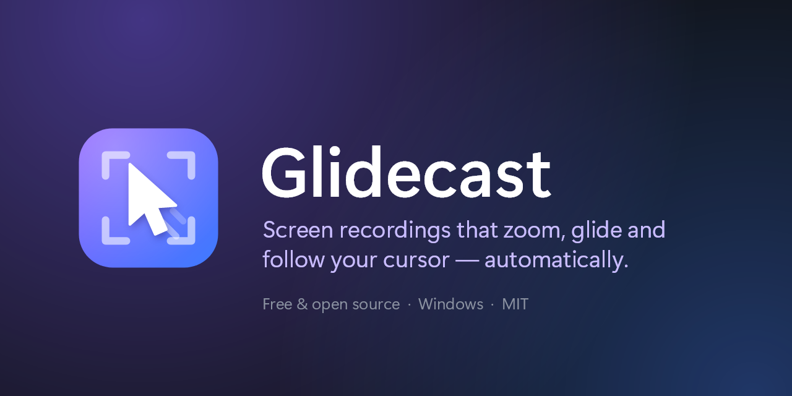
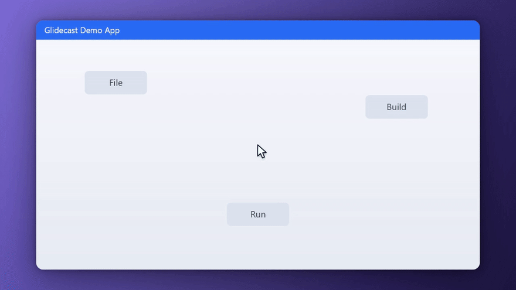
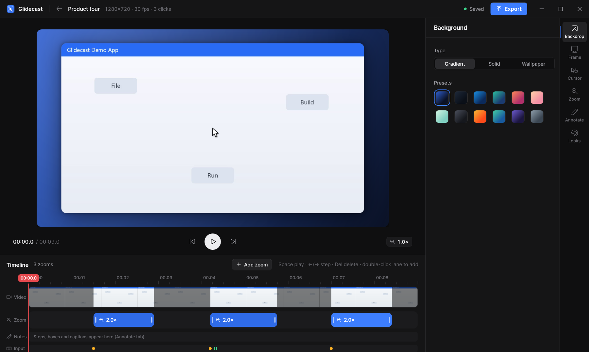
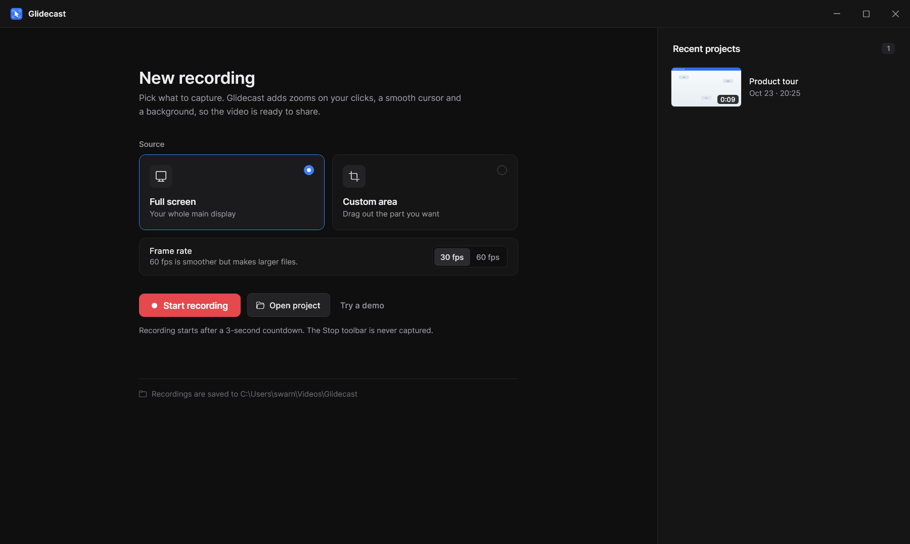
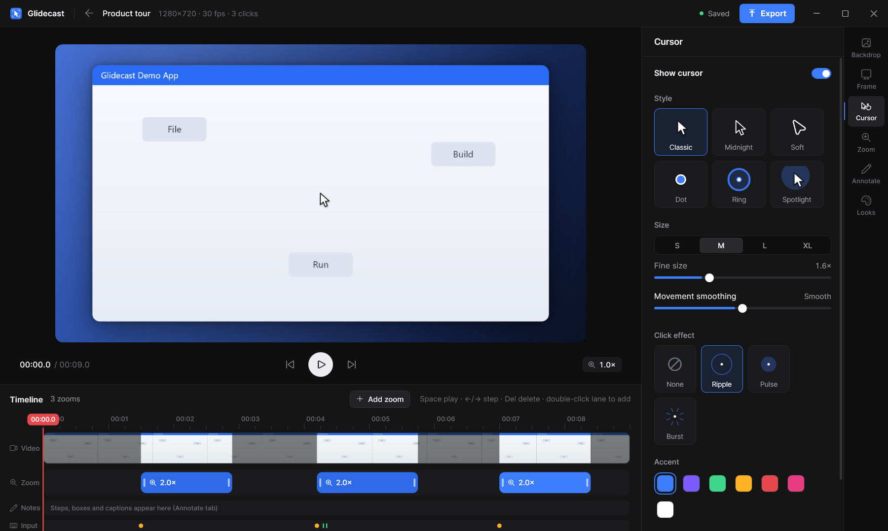

<p align="center">
  
</p>

<p align="center">
  <a href="https://github.com/swarnimbandekar/glidecast/releases/latest"></a>
  <a href="https://github.com/swarnimbandekar/glidecast/actions"></a>
  <a href="LICENSE"></a>
  
</p>

Glidecast is an open-source screen recorder for Windows that turns a raw
screen capture into a finished product video. It records the screen and your
mouse and keyboard input separately, then renders the video through a virtual
camera that zooms in on each click, pans between actions and follows the
cursor. You can adjust everything afterwards, but the first render is usually
ready to share.

<p align="center">
  
</p>

## Download

Get the latest version from the [releases page](https://github.com/swarnimbandekar/glidecast/releases/latest):

| File | Use it when |
|---|---|
| `Glidecast-Setup-<version>-x64.exe` | You want a normal install (recommended). No admin rights needed. |
| `Glidecast-<version>-win-x64-portable.zip` | You want to run it from a folder without installing. |

Both include FFmpeg. Glidecast checks for new versions on startup and can
update itself in place. Every download is verified against the release's
`SHA256SUMS.txt`.

Requires Windows 10 1809 or later, or Windows 11 (x64).

> Release builds are not code-signed yet, so Windows SmartScreen may warn the
> first time you run the installer. Choose **More info → Run anyway**, or
> [build from source](#build-from-source).

## Features

**Recording**
- Full screen or a custom area, at 30 or 60 fps, with a per-frame timestamp so
  video, cursor and zooms stay in sync even when frames drop.
- The recording toolbar is excluded from the capture.
- Crash-safe: an interrupted recording is recovered the next time you open the app.

**Automatic camera**
- Each click becomes a zoom. Nearby clicks merge into one shot, and typing after
  a click stays in frame.
- Smart framing reads the button, menu or dialog under the click (UI
  Automation) and fits the zoom to it.
- Follow typing keeps the text caret in view while you type.
- Spring-based motion with Subtle, Balanced, Dramatic and Tutorial presets.

**Editing**
- Timeline with a film strip and draggable, resizable zoom blocks. Click the
  preview to aim a zoom.
- Annotations: step numbers, highlight boxes, spotlights, arrows and callouts,
  or generate a numbered walkthrough from your clicks.
- Cursor styles, sizes, smoothing, click effects, keystroke overlay and an
  optional motion trail.
- Backgrounds (gradients, solid colors or your own wallpaper), padding, corner
  radius and shadow.
- Looks: save a style as a reusable brand kit and make it the default.

**Export**
- H.264 MP4 at source resolution, 720p, 1080p, 1440p or 4K, at 24, 30 or 60 fps.
- 16:9, 9:16 and 1:1, each with its own camera path. Export all three at once.
- Hardware encoding (NVENC, Quick Sync, AMF) with CPU fallback.

<p align="center">
  
</p>

## Usage

1. **Record.** Choose *Full screen* or *Custom area* and select **Start recording**.
   A 3-second countdown runs first. Select **Stop** on the toolbar when you're done.
2. **Edit.** The editor opens with zooms already placed on your clicks. Use the
   inspector on the right for background, frame, cursor, zoom and annotations.
3. **Export.** Choose the canvas, resolution, frame rate and quality.

| Shortcut | Action |
|---|---|
| `Space` | Play or pause |
| `←` / `→` | Step one frame (hold `Shift` for 5 seconds) |
| `Z` | Add a zoom at the playhead |
| `Delete` | Delete the selected zoom or annotation |
| `Ctrl+E` | Export |

Projects are saved to `Documents\Glidecast`. If Windows Controlled Folder Access
blocks that folder, Glidecast uses `%LOCALAPPDATA%\Glidecast\Recordings`
instead. Each project is a folder containing `source.mp4` and a readable
`project.json`.

<p align="center">
  
  
</p>

## Command line

`glidecast-cli.exe` is installed next to the app.

```powershell
glidecast-cli record 30 .\take                      # record for 30 s (Enter stops early)
glidecast-cli render .\take out.mp4                 # auto-zoom and export
glidecast-cli render .\take out.mp4 --aspect all    # 16:9, 9:16 and 1:1
glidecast-cli annotate .\take                       # add a numbered walkthrough
glidecast-cli batch .\takes --look "Midnight pro" --res 1080 --out .\exports
glidecast-cli look list                             # also: save, apply, default
glidecast-cli encoders                              # hardware encoders available here
glidecast-cli recover                               # rebuild interrupted recordings
```

You can also run your own commands after each recording or export. See
[docs/EXTENDING.md](docs/EXTENDING.md).

### Environment variables

| Variable | Effect |
|---|---|
| `GLIDECAST_FFMPEG` | Path to a specific `ffmpeg.exe` |
| `GLIDECAST_PROJECTS` | Folder for new recordings |
| `GLIDECAST_NO_UPDATE_CHECK=1` | Turn off the update check |

## Build from source

Requires the .NET 8 SDK and FFmpeg on `PATH`.

```powershell
git clone https://github.com/swarnimbandekar/glidecast
cd glidecast
dotnet run --project src/Glidecast -c Release   # run the app
./build.ps1                                     # installer, portable zip and checksums (needs Inno Setup 6)
```

## How it works

Glidecast never draws the cursor into the recording. It captures three streams
on one clock: screen frames with their timestamps, mouse movement and clicks,
and key presses. The final video is composited afterwards with SkiaSharp and
encoded with FFmpeg.

```
screen ─▶ source.mp4 + frame times ─┐
mouse  ─▶ moves and clicks ─────────┼─▶ ZoomAuthor ─▶ CameraTrack ─▶ Compositor ─▶ FFmpeg ─▶ MP4
keys   ─▶ key presses ──────────────┘
```

[docs/ARCHITECTURE.md](docs/ARCHITECTURE.md) covers each stage in detail.

## Roadmap

- Audio capture (microphone and system)
- Webcam overlay
- Undo and redo
- Trimming and cutting
- Multi-monitor region selection
- Code-signed releases

## Contributing

Bug reports and pull requests are welcome. See [CONTRIBUTING.md](CONTRIBUTING.md).

## License

[MIT](LICENSE). Copyright © 2026 Swarnim Bandekar and Glidecast contributors.
Third-party components and their licenses are listed in
[THIRD_PARTY_NOTICES.md](THIRD_PARTY_NOTICES.md).
